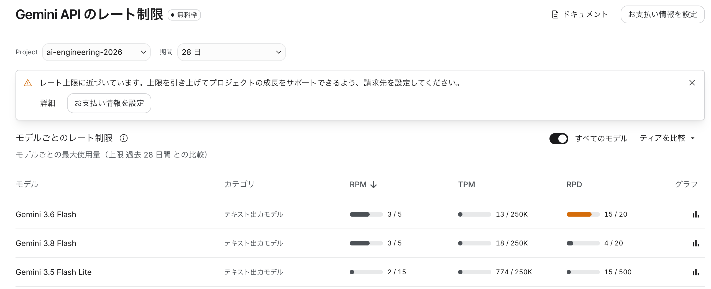

# 第1回 解答

## 演習

- 講座に固有の質問（宿題の3レベル）へのモデルの回答（要約でよい）：
  ```
  on -m app.ask "AIE2026の講座の宿題にある「3レベル」とは何ですか？"
  [model] gemini-3.5-flash-lite
  [質問] AIE2026の講座の宿題にある「3レベル」とは何ですか？

  [トークン数] 入力: 21, 出力: 628
  AIE2026（AIエンジニア育成講座2026年版など）の宿題における「3レベル」についてですね。

  一般的に、AIやプログラミングの学習プログラム（AIE講座など）における「3レベルの宿題」は、受講生の現在のスキルや理解度に合わせて、**難易度や取り組み方を選択できるように設定された課題**を指します。

  文脈によって多少異なりますが、多くの場合、以下のような構成になっています。

  ---

  ### 一般的な「3レベル」の分類

  #### 1. レベル1（基礎・初級：Level 1）
  * **目的:** 基本概念の理解、コードの模倣、環境構築の確認。
  * **内容:** 
    * 授業でやったコードをそのまま動かしてみる。
    * 穴埋め問題や、指定された通りに変数を書き換える程度の簡単な作業。
    * 初学者や、まだ内容に自信がない人が「まず成功体験を得る」ためのレベル。

  #### 2. レベル2（応用・中級：Level 2）
  * **目的:** 自力での実装、少しのロジック変更、エラーシューティング。
  * **内容:**
    * 授業のコードをベースにしつつ、自分のアイデアや条件を追加してコードを書き換える。
    * 「こういう条件の時はどうするか？」という少し発展的な問いに答える。
    * 実務や次のステップに向けた標準的なレベル。

  #### 3. レベル3（発展・上級：Level 3）
  * **目的:** 応用力のテスト、ゼロからの実装、高度な課題解決。
  * **内容:**
    * ヒントが少なく、自分で調べながらゼロからコードを書く、あるいは複数の技術を組み合わせる。
    * 発展的なアルゴリズムの実装や、エラーが起きても自分で完全に解決する力が求められる。
    * 既にその言語やAIの知識がある人、あるいは限界まで挑戦したい人向けのレベル。

- 用語集の正しい意味と比べて気づいたこと：
  - 講義での3レベルとは基礎・実装・発展のこと。
  - LLMの回答は、基礎・応用・発展であった。
  - 講義内での定義とは一致していないものの、意味的にはほぼ同じである。LLMは推測により回答したことがわかる。
- 表示できたトークン数（入力 / 出力）：入力: 21, 出力: 628

## 宿題

### 取り組んだレベル：基礎
- やったこと：
  - 同じ質問を3回ずつ実行した。
    - 質問：LoRAとは何ですか？
    - temperature 0.2, 0.8の2種類
    - model gemini-3.5-flash-lite

- 結果：
  - temperature=0.2
    - やや変化のある表現が返ってきた。例えば、LoRAについて「一言で言うと」の説明だけをみても以下のように変化した。
      - 1回目：AI全体の頭脳を作り直さず、部分的に付箋を貼るような感覚で、少ないコストと時間でAIを自分好みにカスタマイズする技術です。
      - 2回目：AIの頭脳全体を書き換えることなく、効率よく特定のスタイルや知識を追加学習させる技術です。
      - 3回目：AIの頭脳全体を書き換えるのではなく、一部の小さなパーツだけを追加して、特定のキャラクターや画風、専門知識を覚え込ませる技術です。
  - temperature=0.8
    - 幅のある回答が返ってきた。回答の見出しもバリエーションのあるものとなった。

### 取り組んだレベル：実装
- やったこと：
  - 会話履歴を保ったまま続けて質問できるようにask.pyを改修した。
- 結果：
  - 続けての質問に対して、前回の回答に基づいて回答を返すようになった。
    - 最初の質問：LoRAとは何ですか？
      - 回答：画像生成AI（Stable Diffusionなど）、大規模言語モデル（LLMなど）の2種類で使われていることを回答した。
    - 続けての質問：他にどんなところで使われていますか？
      - 回答：音声合成・音声認識（音声AI）、3Dモデル生成・グラフィックス、動画生成AI、ロボティクス・自動運転（AIエージェント）、マルチモーダルAI（画像・音声・テキストの融合）で使われていることを回答した。

### 取り組んだレベル：発展
- やったこと：
  - 応答時間とトークン数について、3回の平均を出力するように実装した。
- 結果：
  - model: gemini-3.5-flash
    ```
    [1/3回目] [応答時間] 17.57秒 [トークン数] 入力: 7, 出力: 658
    [2/3回目] [応答時間] 12.26秒 [トークン数] 入力: 7, 出力: 713
    [3/3回目] [応答時間] 12.43秒 [トークン数] 入力: 7, 出力: 818
    [平均応答時間] 14.09秒（3回）
    [平均トークン数] 入力: 7.0, 出力: 729.7
    ```
  - model: gemini-3.5-flash-lite
    ```
    [1/3回目] [応答時間] 36.74秒 [トークン数] 入力: 7, 出力: 655
    [2/3回目] [応答時間] 19.64秒 [トークン数] 入力: 7, 出力: 639
    [3/3回目] [応答時間] 24.63秒 [トークン数] 入力: 7, 出力: 730
    [平均応答時間] 27.00秒（3回）
    [平均トークン数] 入力: 7.0, 出力: 674.7
    ```
  - Gemini APIのレート制限
    * モデルごとにレート制限は異なる
    

- 気づき・疑問：
  - 利用可能なモデルの一覧を出力する機能を実装した。出力結果は以下の通り。
    ```
    利用可能なモデル:
    - models/gemini-2.5-flash (Gemini 2.5 Flash)
    - models/gemini-2.5-pro (Gemini 2.5 Pro)
    - models/gemini-2.5-flash-preview-tts (Gemini 2.5 Flash Preview TTS)
    - models/gemini-2.5-pro-preview-tts (Gemini 2.5 Pro Preview TTS)
    - models/gemma-4-26b-a4b-it (Gemma 4 26B A4B IT)
    - models/gemma-4-31b-it (Gemma 4 31B IT)
    - models/gemini-flash-latest (Gemini Flash Latest)
    - models/gemini-flash-lite-latest (Gemini Flash-Lite Latest)
    - models/gemini-pro-latest (Gemini Pro Latest)
    - models/gemini-2.5-flash-lite (Gemini 2.5 Flash-Lite)
    - models/gemini-2.5-flash-image (Nano Banana)
    - models/gemini-3-flash-preview (Gemini 3 Flash Preview)
    - models/gemini-3.1-pro-preview (Gemini 3.1 Pro Preview)
    - models/gemini-3.1-pro-preview-customtools (Gemini 3.1 Pro Preview Custom Tools)
    - models/gemini-3.1-flash-lite-preview (Gemini 3.1 Flash Lite Preview)
    - models/gemini-3.1-flash-lite (Gemini 3.1 Flash Lite)
    - models/gemini-3-pro-image-preview (Nano Banana Pro)
    - models/gemini-3-pro-image (Nano Banana Pro)
    - models/nano-banana-pro-preview (Nano Banana Pro)
    - models/gemini-3.1-flash-image-preview (Nano Banana 2)
    - models/gemini-3.1-flash-image (Nano Banana 2)
    - models/gemini-3.1-flash-lite-image (Nano Banana 2 Lite)
    - models/gemini-nano-banana-2.1 (Nano Banana 2.1)
    - models/gemini-3.5-flash (Gemini 3.5 Flash)
    - models/gemini-3.5-flash-lite (Gemini 3.5 Flash Lite)
    - models/gemini-omni-flash-preview (Gemini Omni Flash Preview)
    - models/gemini-omni-1.1-flash (Gemini Omni 1.1 Flash)
    - models/gemini-3.5-transcribe (Gemini 3.5 Transcribe)
    - models/gemini-3.6-flash (Gemini 3.6 Flash)
    - models/gemini-3.7-flash (Gemini 3.7 Flash)
    - models/gemini-3.8-flash (Gemini 3.8 Flash)
    - models/gemini-4-argon (Gemini 4 Argon)
    - models/lyria-3-clip-preview (Lyria 3 Clip Preview)
    - models/lyria-3-pro-preview (Lyria 3 Pro Preview)
    - models/lyria-3.5 (Lyria 3.5)
    - models/gemini-3.1-flash-tts-preview (Gemini 3.1 Flash TTS Preview)
    - models/gemini-3.8-flash-tts (Gemini 3.8 Flash TTS)
    - models/gemini-3.8-flash-lite-tts (Gemini 3.8 Flash Lite TTS)
    - models/gemini-robotics-er-2-preview (Gemini Robotics-ER 2 Preview)
    - models/gemini-2.5-computer-use-preview-10-2025 (Gemini 2.5 Computer Use Preview 10-2025)
    - models/antigravity-preview-05-2026 (Antigravity Agent Preview)
    - models/antigravity-preview-09-2026 (Antigravity Agent Preview)
    - models/antigravity-preview-latest (Antigravity Agent Preview Latest)
    - models/deep-research-max-preview-04-2026 (Deep Research Max Preview (Apr-21-2026))
    - models/deep-research-preview-04-2026 (Deep Research Preview (Apr-21-2026))
    - models/deep-research-pro-preview-12-2025 (Deep Research Pro Preview (Dec-12-2025) [Rerouted])
    - models/gemini-embedding-001 (Gemini Embedding 001)
    - models/gemini-embedding-2-preview (Gemini Embedding 2 Preview)
    - models/gemini-embedding-2 (Gemini Embedding 2)
    - models/aqa (Model that performs Attributed Question Answering.)
    - models/gemini-3.5-transcribe-live (Gemini 3.5 Transcribe Live)
    - models/gemini-2.5-flash-native-audio-latest (Gemini 2.5 Flash Native Audio Latest)
    - models/gemini-2.5-flash-native-audio-preview-09-2025 (Gemini 2.5 Flash Native Audio Preview 09-2025)
    - models/gemini-2.5-flash-native-audio-preview-12-2025 (Gemini 2.5 Flash Native Audio Preview 12-2025)
    - models/gemini-3.1-flash-live-preview (Gemini 3.1 Flash Live Preview)
    - models/gemini-3.8-live (Gemini 3.8 Live)
    - models/gemini-3.8-live-extended-thinking (Gemini 3.8 Live Extended Thinking)
    - models/gemini-robotics-er-2-streaming-preview (Gemini Robotics-ER 2 Streaming Preview)
    - models/gemini-3.5-live-translate-preview (Gemini 3.5 Live Translate Preview)
    - models/lyria-realtime-exp (Lyria Realtime Experimental)
    ```
